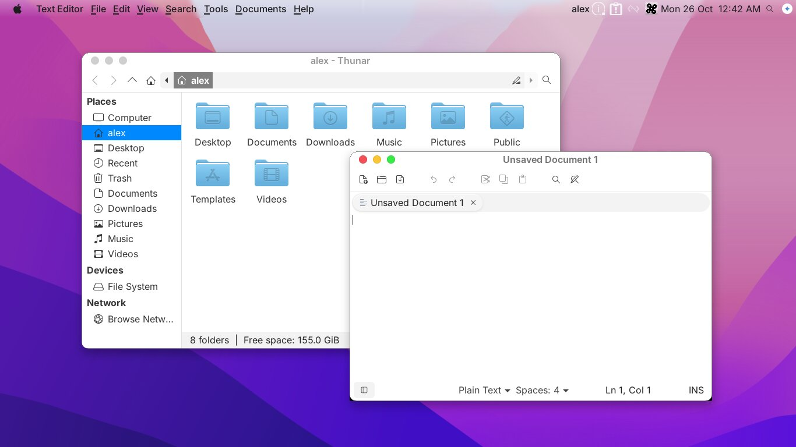
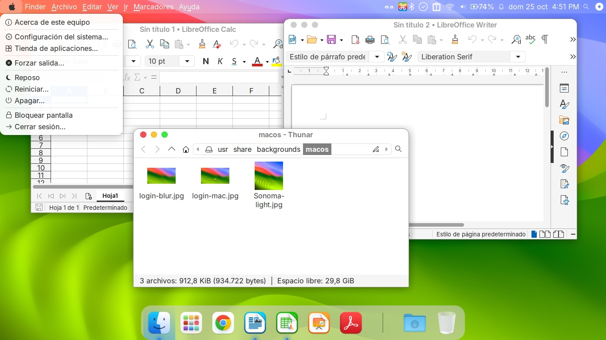
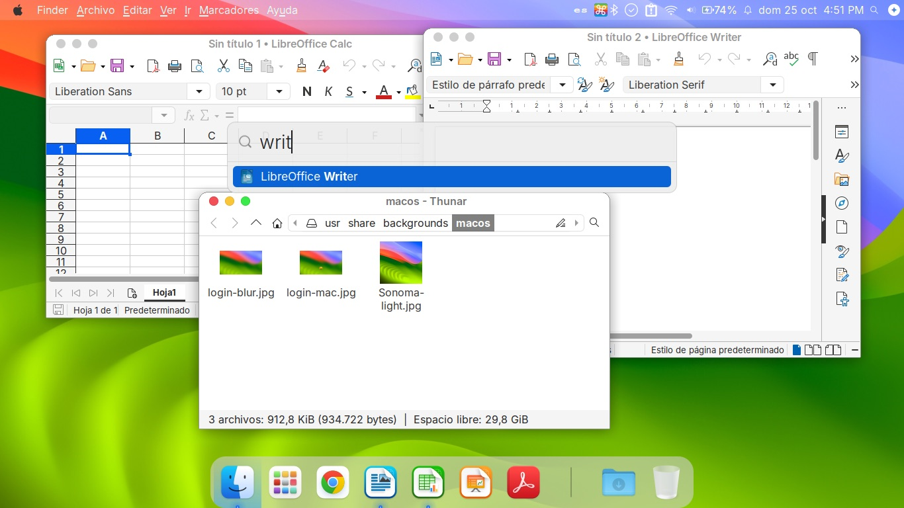
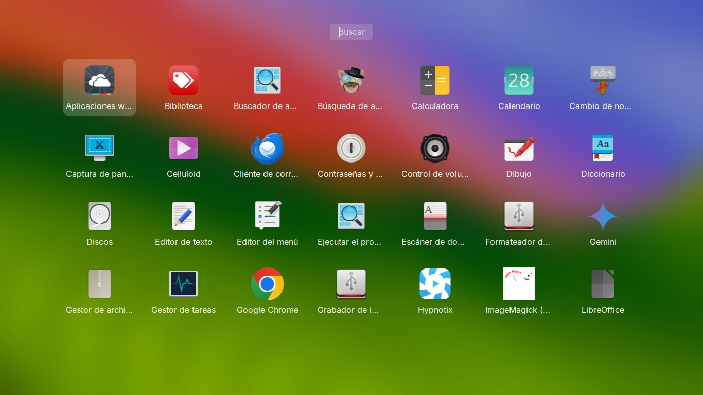
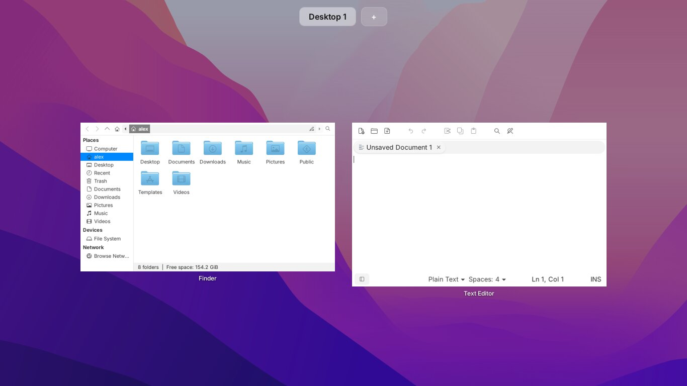
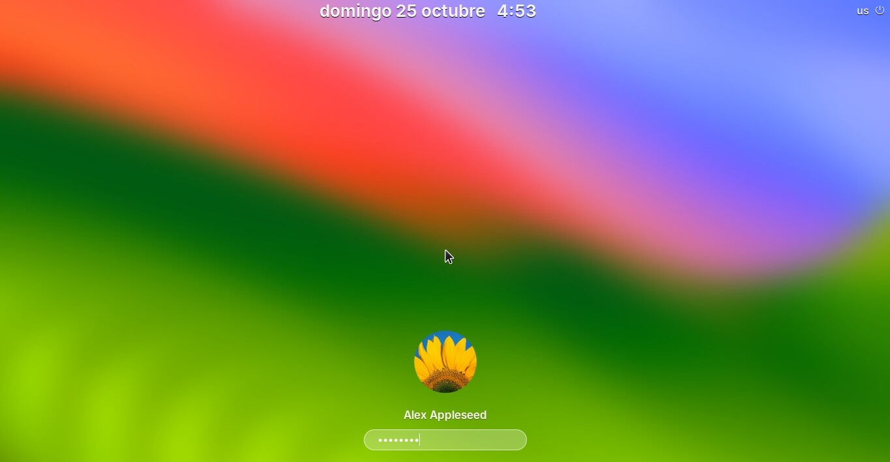

# mintosh

**Mint + Macintosh: an open-source macOS skin for Linux Mint Xfce, plus a kit for moving an old Mac to it
without losing anything.** (Formerly `mac-to-mint`.)

Old Macs that Apple no longer updates still make good computers. These scripts put Linux Mint Xfce on one and
make it look and work like macOS, so whoever used the Mac doesn't have to relearn it:

- Apple menu, a global menu bar (the app's name and its File/Edit/View menus at the top), macOS-ordered status icons
- Dock, Spotlight (⌘Space), Launchpad (F4) and Mission Control (three-finger swipe up)
- ⌘C/⌘V/⌘Q/⌘W/⌘Tab and the other Mac shortcuts, Mac trackpad gestures
- Black boot screen with an Apple logo, a Sonoma-style login screen
- Battery warnings, sleep on lid close, and the fixes 2013-2015 MacBooks need to run Linux reliably



| | |
|---|---|
|  **Apple menu** |  **Spotlight** (⌘Space) |
|  **Launchpad** (F4, dock, pinch) |  **Mission Control** (three-finger swipe up, F3) |
|  **Login screen** | |

<sub>Real screenshots from the 2013 MacBook Air at 1366x768. That machine was set up with Spanish as a second language,
which is why the menus are in Spanish; by default everything is English.
Finder's sidebar is hidden and the login screen shows a demo account.</sub>

It all runs on a 4 GB, 2013 MacBook Air: the search and launcher windows only exist while open, so nothing extra
sits in memory. The look comes from the excellent [WhiteSur](https://github.com/vinceliuice/WhiteSur-gtk-theme)
themes and [Toshy](https://github.com/RedBearAK/toshy); this repo wires them, and a lot of small fixes, together.

**Just want the skin?** On any Linux Mint 22 Xfce machine (Mac or not), run scripts 3, 4 and 5 from step 4 below.
The hardware fixes only switch on when that hardware is present.

**Status:** tested end to end on one MacBookAir6,1 (2013) with Mint 22.3 Xfce, in English and Spanish. Other
models and versions should mostly work but are untested - issues and pull requests welcome.

No personal data lives in this repo. Backups go in `$BACKUP_DIR` on the helper Mac (e.g. `~/backups/<machine>`).

## Steps

### 1. Back up the old Mac (from a helper Mac)
1. On the old Mac: System Preferences > Sharing > **Remote Login** on.
2. `ssh-keygen -t ed25519 -f ~/.ssh/mintosh && ssh-copy-id -i ~/.ssh/mintosh user@ip`
3. `BACKUP_DIR=~/backups/<machine> bash 1-backup/backup-over-ssh.sh user@ip [/Volumes/<extra partition> ...]`
4. Verify: compare file counts on both sides, and spot-check checksums of random files.
   Expect a few hundred missing files from caches under `Library/Containers` - fine.
5. Note anything only the Mac has: Chrome signed in and **Sync on**? (else export passwords), Mail accounts,
   Photos libraries (also on extra partitions), printers (`lpstat -p`), personal files saved in odd places.

### 2. Convert and organise (on the helper Mac)
```
python3 -I 2-organize/convert.py   $BACKUP_DIR/home $BACKUP_DIR/converted   # Mail, Contacts, Calendar, Notes, Safari, Photos
python3 -I 2-organize/inventory.py $BACKUP_DIR $BACKUP_DIR/report               # sizes, kinds, duplicates, junk
# edit the SOURCE RULES in organize.py for this machine, then:
python3 -I 2-organize/organize.py  $BACKUP_DIR $BACKUP_DIR/organized --dry-run
python3 -I 2-organize/organize.py  $BACKUP_DIR $BACKUP_DIR/organized
```
The raw backup is never modified; `organized/` is built with APFS clones (no extra space) and `_log/`
logs every file kept, every duplicate skipped (with the copy kept) and every junk file dropped.

### 3. Install Mint
- Download the Mint Xfce ISO and check its SHA-256. Write it with **balenaEtcher** (it verifies the write;
  `dd` from a script is blocked by macOS privacy controls). A bad stick shows up later as random
  "Input/output error"s in the live session - re-flash or use another stick.
- Boot holding **Option**, pick **EFI Boot**. Add model boot options if needed (see Hardware notes) by pressing
  `e` on the boot entry and appending them to the `linux` line.
- Partitioning (manual, "Something else"): EFI 512 MB, `/` ext4 ~60 GB, `/home` ext4 rest. A separate `/home`
  survives a reinstall. (Splitting an existing install: shrink `/` from the live USB with `e2fsck -f`,
  `resize2fs`, `parted resizepart`, then `mkpart`, `mkfs.ext4`, copy `/home`, add it to `/etc/fstab` by UUID.)
- Install in English with the right keyboard layout; tick third-party drivers.

### 4. Set up (on the new install)
```
sudo apt install openssh-server                                          # on the new install
BACKUP_DIR=~/backups/<machine> bash 3-linux/0-send-from-mac.sh user@ip   # from the helper Mac
cd ~/mac-setup/3-linux
sudo bash 1-system-setup.sh   # hardware fixes, Chrome, LibreOffice, fonts, printers... then reboot
bash 2-restore-files.sh       # organized/ -> Desktop, Documents, Pictures, Music, Videos
bash 3-macos-look.sh          # macOS look (run inside the desktop session)
sudo bash 4-macos-system.sh   # boot + login screen, trackpad, battery saving (after script 3)
bash 5-mac-shortcuts.sh       # Mac keyboard shortcuts (Toshy); then restart
```
English only by default. For a second language add `LANG2=es_CO` to script 1 (`sudo LANG2=es_CO bash
1-system-setup.sh`) and `KBD=es` to script 3 for a second keyboard layout.
Then: Timeshift (system only, daily), sign in to Chrome, import Safari bookmarks if needed, delete
`~/mac-setup`, remove the helper key from `~/.ssh/authorized_keys`, and turn SSH off:
`sudo systemctl disable --now ssh.socket ssh` (Mint 22 listens through `ssh.socket` as well).

To come back later (re-run scripts 3-5 after changes): `bash tools/open-access.sh` on the helper Mac prints a
`wget ... | bash` line to run on the Mint machine (temporary key + password-free sudo + SSH on). Then
`bash 3-linux/0-send-from-mac.sh user@ip` (no BACKUP_DIR: sends only the scripts), run them, and
`bash tools/close-access.sh user@ip` to undo the access.

> **Safety:** `open-access.sh` serves its script over plain HTTP on your local network, and running it gives the
> helper Mac SSH access with password-free sudo. Use it only on a network you trust, keep the server running only
> until the command has been run, and always finish with `close-access.sh`. Read the served script before running
> it - the same goes for any `wget | bash`.
Keep a second copy of `organized/` + `converted/` before deleting the raw backup.

## What the scripts set up
- **System:** English only by default. Optional second language: `LANG2=es_CO` for script 1 (language packs,
  LibreOffice, spell check; switch in Settings > Languages) and `KBD=es` for script 3 (a second keyboard layout,
  Alt+Shift, shown in the top bar). Chrome as default browser, LibreOffice saving
  .docx/.xlsx/.pptx by default, MS core fonts + Carlito/Caladea, Inter (SF Pro stand-in), Epson/Canon drivers,
  automatic updates, password login (autologin off so the keyring unlocks itself).
- **macOS look:** WhiteSur theme, `WhiteSur-light` icons (plain `WhiteSur` icons are white and vanish in a light
  menu), cursor, Inter font, window buttons on the left, centred titles, shadows, double-click to zoom, Plank dock
  (Finder, Launchpad, apps | Downloads, Trash), rotating macOS-style wallpapers, volume/brightness pop-ups,
  rounded top-right notifications, only files on the desktop, Thunar renamed Finder with Finder-like settings.
- **Menu bar:** Apple menu (Xfce's Applications Menu on a custom `.menu` file: About This Computer, System
  Settings, App Store, Force Quit, Sleep, Restart, Shut Down, Lock Screen, Log Out, with separators), then the
  global menu (`xfce4-appmenu-plugin`: active app's name in bold + its File/Edit/View menus, out of the window;
  works for Chrome, LibreOffice and GTK apps). Right side as on macOS: keyboard layout, tray icons, Wi-Fi, volume,
  battery %, "Sun 25 Oct 3:42 PM", Search, Gemini. Regular-weight text (WhiteSur makes it bold). Mint's Firefox/Terminal/Files
  launchers, show-desktop, window buttons and Languages button are removed.
- **Spotlight (⌘Space) and Launchpad (F4, dock):** rofi, not Ulauncher: it starts on demand and exits, so it uses no
  memory while closed (Ulauncher stays resident, ~100 MB+, too much for 4 GB). Spotlight: Sonoma-style bar, results
  appear once you type, apps then the user's files. Launchpad: full-screen grid on the blurred wallpaper; one click opens.
- **Keys:** Toshy gives ⌘C/⌘V/⌘Q/⌘W/⌘Tab; ⌘⇧3 / ⌘⇧4 save screenshots to the Desktop. Tapping ⌘ alone does nothing.
- **Boot and login:** black screen with a white Apple logo and progress bar (Plymouth script theme), GRUB menu hidden
  (Shift/Esc shows it); a Sonoma-style login screen (lightdm-gtk-greeter): big date and time at the top, a round
  account picture, the name and a translucent password field at the bottom of the blurred wallpaper. The picture
  is one of macOS's own (`AVATAR=`, from `/Library/User Pictures` on the helper Mac), never committed.
- **Trackpad:** natural scrolling, tap to click, two-finger click = right click; three fingers up/down = Mission
  Control (live window previews, F3 too); thumb + three fingers pinch = Launchpad, spread = show desktop (Touchegg).
  One desktop, as a Mac starts with.
- **Battery:** dims on battery, lid = sleep, sleeps at 5 %, "Low Battery" warnings at 20 % and 10 % (UPower's
  figure, as in the menu bar; the kernel's `capacity` reads lower on this Mac), TLP.
- **Chrome language:** at each login Chrome's website languages are set from the system language (e.g. es-CO
  first when the system is switched to Spanish) and the Translate pop-up is off for those languages. Chrome must be closed for this.
- **Gemini:** Google's assistant as its own app window (Chrome `--app`), with a button at the far right of the menu
  bar where Siri was on macOS 10.12 (sparkle on a white circle so it shows on any wallpaper). There's no
  Gemini desktop app for Linux. Chrome's built-in "Gemini in Chrome" and its dictation into web text boxes
  ("Talk to type", Chrome 156) are rolling out by country; Linux availability is unclear, so check Chrome itself.
  The Apple logo and Gemini icon are downloaded at run time (WhiteSur source, gstatic), not stored here.

## Hardware notes (MacBookAir6,1, 2013) - most apply to 2013-2015 MacBooks
| Problem | Fix (in `1-system-setup.sh`, gated on the hardware) |
|---|---|
| SSD invisible to the installer; `ata1: failed to IDENTIFY` (Marvell 88SS9183, `1b4b:9183`) | boot with `intel_iommu=off` |
| Desktop freezes after ~1 h, hundreds of `ata1: hard resetting link`, I/O errors | SATA link power saving off: `ahci.mobile_lpm_policy=1` |
| No Wi-Fi in the installer (Broadcom BCM4360) | `bcmwl-kernel-source` (on the Mint ISO); Driver Manager in the live session |
| No camera (FaceTime HD, `14e4:1570`) | `facetimehd` driver + firmware via DKMS |
| Runs hot | `mbpfan` |
| Top-row keys | work by default (`hid_apple fnmode=3`); pop-ups need enabling (script 3) |

**TLP undoes the SATA fix** unless told not to: its defaults turn SATA link power management back on on battery.
Script 4 writes `/etc/tlp.d/90-apple.conf` (`SATA_LINKPWR_ON_BAT=max_performance`, AHCI runtime PM off, Wi-Fi
power saving off) on Apple hardware.

`libata.force=noncq,1.5Gbps` is **not** needed - with the two options above the SSD runs at 6 Gb/s with NCQ.

## Lessons
- Run scripts that change the desktop (panel, dock) inside the session, not over SSH: an SSH-started panel or
  dock loses the session environment (no transparency, plank refuses to start). Logging out and in fixes it.
- `pkill -f "<pattern>"` inside `ssh host '...<pattern>...'` kills its own shell. Kill by PID or exact name.
- WhiteSur's installer needs `TERM` set (it calls `setterm`) and writes the Whisker menu opacity to a file
  Xfce 4.18+ ignores; set `menu-opacity` < 100 through xfconf or the menu gets black corners.
- Don't restart the panel (`xfce4-panel -r`) more than needed: it can take nm-applet, blueman and the update icon
  down with it. Relaunch them from their `/etc/xdg/autostart` entries, or log out and in.
- Files the panel watches (custom menus) must be replaced atomically, or it shows "Could not load the applications
  menu" while the file is half written.
- Test changes on the real machine with screenshots: `import -window root` + `convert -crop`, crop on the target so
  only the part being checked leaves the machine.
- Preview the login screen without logging out: `lightdm --test-mode` from the desktop opens it in a Xephyr
  window. Put a wrapper named `Xephyr` that adds `-screen 1366x768` first in `PATH` to see it at the real size.
- lightdm-gtk-greeter: style the password field as `#login_window entry` (its builder ids aren't all widget names),
  and build its theme on GTK's own Adwaita, not WhiteSur, whose entry rules win and leave the dots unreadable.
- lightdm-gtk-greeter left-aligns the user name inside its (fixed-width) box. On a one-person machine script 4 draws
  the name centred on the background and hides the box's text; `LOGIN_NAME=` overrides the drawn name.
- Two copies of `appmenu-gtk-module` (xsettings `/Gtk/Modules` plus `GTK_MODULES`) make Chrome segfault on start.

## Undoing things
- Login screen: `sudo rm /etc/lightdm/lightdm.conf.d/95-macos-greeter.conf` (back to Mint's slick-greeter).
- Boot screen: `sudo update-alternatives --config default.plymouth` (pick `mint-logo`), then `sudo update-initramfs -u`;
  GRUB menu: `sudo rm /etc/default/grub.d/99-macos-boot.cfg && sudo update-grub`.
- Trackpad: `sudo rm /etc/X11/xorg.conf.d/90-mac-touchpad.conf`. Gestures: `sudo apt remove touchegg`.
- Mac shortcuts: `python3 ~/.cache/toshy-src/setup_toshy.py uninstall`.
- Top bar back to Mint's: `xfce4-panel --quit; xfconf-query -c xfce4-panel -p / -R -r; xfce4-panel &` (log out and in).
- Battery saver: `sudo apt remove tlp`.

## Credits
Downloaded or installed at run time, not redistributed here:
[WhiteSur GTK theme, icons, cursors and wallpapers](https://github.com/vinceliuice) (vinceliuice),
[Toshy](https://github.com/RedBearAK/toshy), [rofi](https://github.com/davatorium/rofi),
[Touchégg](https://github.com/JoseExposito/touchegg), [vala-panel-appmenu](https://github.com/rilian-la-te/vala-panel-appmenu),
[Plank](https://launchpad.net/plank), [lightdm-gtk-greeter](https://github.com/Xubuntu/lightdm-gtk-greeter),
[TLP](https://linrunner.de/tlp/), [facetimehd](https://github.com/patjak/facetimehd), [mbpfan](https://github.com/linux-on-mac/mbpfan),
and Linux Mint and Xfce themselves. Each keeps its own licence.

## License and trademarks
The scripts and docs in this repo are MIT-licensed (see `LICENSE`). Apple, the Apple logo, macOS, Mac, MacBook,
Finder, Spotlight, Launchpad and Mission Control are trademarks of Apple Inc.; Google, Chrome and Gemini are
trademarks of Google LLC. This project is not affiliated with or endorsed by Apple or Google. The Apple logo is
taken from the WhiteSur sources at run time and the macOS account picture from the helper Mac's own files; neither
is stored in this repo. Use it on hardware you own.
